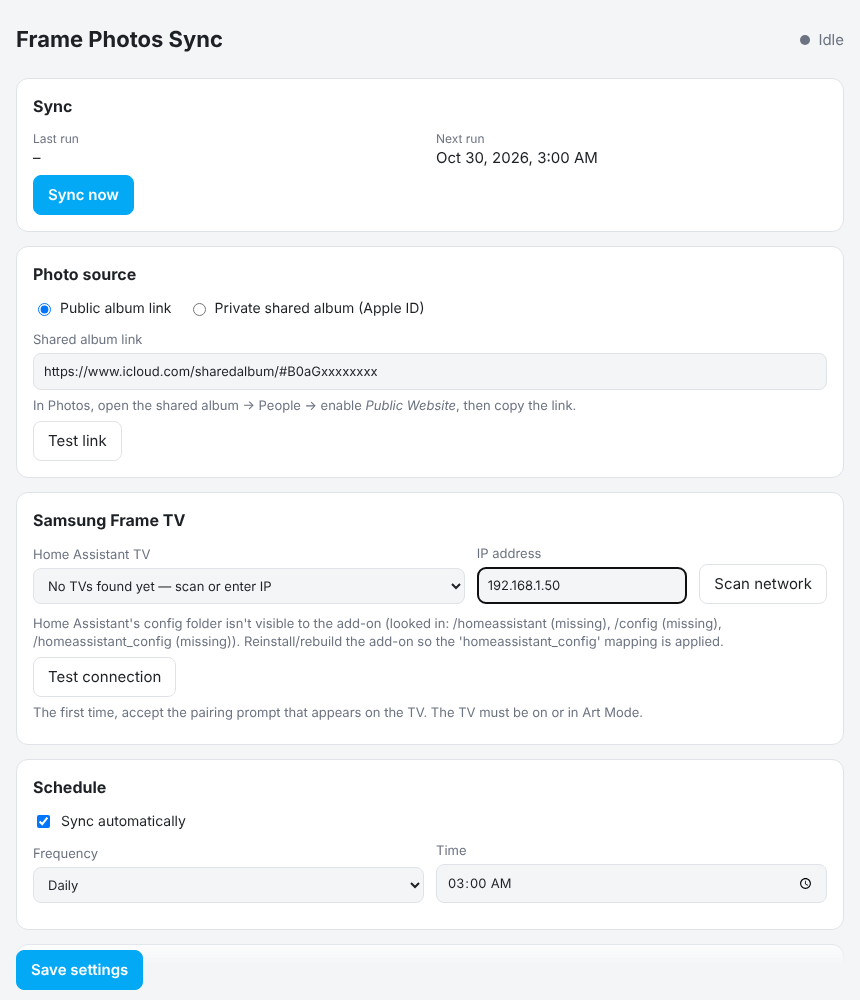

<p align="center"></p>

# Frame Photos Sync

A Home Assistant add-on that copies photos from an **iCloud shared album** to your
**Samsung Frame TV** as Art Mode pictures, automatically, on a schedule.

[](https://my.home-assistant.io/redirect/supervisor_add_addon_repository/?repository_url=https%3A%2F%2Fgithub.com%2Fandrewgbooth%2FFrameHAPhotosSync)



## Features

- **Public or private albums**: use a public shared-album link (no Apple ID), or sign in with your
  Apple ID (2FA supported) to read private shared albums, including ones shared with you.
- **Frame-ready photos**: every photo is cropped or fitted to exactly 16:9 (3840×2160), converted to
  sRGB and saved as a small baseline JPEG, so the TV accepts it. Smart crop keeps the interesting part of
  the photo; portrait photos can be fitted over a blurred background instead.
- **Schedule**: daily, weekly or monthly, at a time you choose.
- **Tidy**: removes the photos it uploaded last time (verified, retried if the TV is slow). Rotation,
  shuffle and Art Mode are optional extras (off by default); by default they stay under the TV's own
  control: choose *My Photos* once in the TV's Art Mode settings and it keeps using what the add-on uploads.
- **Find your TV**: picks up Samsung TVs from Home Assistant, or scans the network (SSDP, mDNS and a
  subnet probe) for Frames, including ones only known to SmartThings.
- **Web UI** in the sidebar: settings, album preview (with *On TV* markers), *Sync now*, activity log.

## Install

1. Click the button above, or in Home Assistant go to **Settings → Add-ons → Add-on Store → ⋮ →
   Repositories** and add `https://github.com/andrewgbooth/FrameHAPhotosSync`.
2. Install **Frame Photos Sync**, start it and enable **Show in sidebar**.
3. Open **Frame Photos**, choose your album and TV, press **Save settings**, then **Sync now**.

Full instructions are in [the add-on documentation](framehaphotossync/DOCS.md).

## Photos of particular people

iCloud doesn't expose its *People* albums to apps. Create a **Smart Album** in Photos on a Mac
(*Person is …*), then use an Apple Shortcut to add its photos to a shared album. This add-on reads that
shared album.

## Notes and limitations

- The TV must be reachable on the network (on or in Art Mode). It is not woken if fully off.
- The add-on runs with host networking so that network discovery works.
- Private albums need your Apple ID password, stored in the add-on's private data folder. Accounts with
  Advanced Data Protection may not work. Apple occasionally asks for a fresh 2FA code.
- Unofficial project, not affiliated with or endorsed by Apple or Samsung.

## License

[MIT](LICENSE)

## Development

```bash
python -m venv .venv
.venv/bin/pip install -r framehaphotossync/requirements.txt pytest
.venv/bin/python -m pytest tests
cd framehaphotossync && DATA_DIR=./data ALLOW_ANY_IP=1 ../.venv/bin/python -m app.main   # UI on :8099
python tools/make_art.py [--photo picture.jpg]   # regenerate icon.png / logo.png
```
